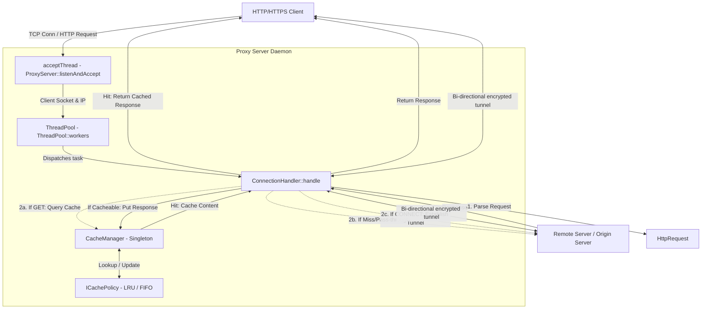

# Corporate HTTP Caching Proxy Server - Architecture & Technical Documentation

This document provides a detailed explanation of the architecture, design patterns, core components, and low-level code implementation of the Corporate Caching HTTP Proxy Server.

---

## 1. High-Level Architecture Overview

The system is a multi-threaded, high-performance HTTP/HTTPS proxy server daemon built with **C++17** and standard POSIX BSD sockets. It is designed to intercept client HTTP requests, serve cached responses when applicable (reducing bandwidth and latency), and establish raw bidirectional TCP tunnels for secure HTTPS traffic.

### Architectural Blueprint

---

## 2. Core Project Components & Class Design

The codebase is structured cleanly into dedicated modules:

### 2.1. Network Handling & Server Loop
- **[ProxyServer](file:///home/baabbabai/GitHub/Project_Mireacle/4th-semester/PoCS/Proxy-Project-4/include/ProxyServer.h) & [ProxyServer.cpp](file:///home/baabbabai/GitHub/Project_Mireacle/4th-semester/PoCS/Proxy-Project-4/src/ProxyServer.cpp)**
  Manages the lifecycle of the daemon. It initializes the listening TCP socket, binds to the designated port, sets `SO_REUSEADDR`, and configures the singleton cache policy.
  - `start()`: Pre-allocates the thread pool, boots the `acceptThread` invoking `listenAndAccept()`.
  - `stop()`: Atomically flags the running status to `false`, closes the listening socket, and joins the threads.
  - `listenAndAccept()`: Run on a dedicated background thread. It polls the server socket status using `select()` with a 1-second timeout. When a connection is ready, it calls `accept()` to spawn a client socket, queries the client IP via standard socket parameters, and pushes a task to process this connection into the `ThreadPool`.

- **[ConnectionHandler](file:///home/baabbabai/GitHub/Project_Mireacle/4th-semester/PoCS/Proxy-Project-4/include/ConnectionHandler.h) & [ConnectionHandler.cpp](file:///home/baabbabai/GitHub/Project_Mireacle/4th-semester/PoCS/Proxy-Project-4/src/ConnectionHandler.cpp)**
  Handles individual client connections inside a thread pool worker thread.
  - `handle()`: Reads the raw HTTP request, calls the parser, and forwards the execution to one of three workflows:
    1. **GET Request (`handleGet()`)**: Looks up target URL in the cache. If present (Hit), responds immediately. Otherwise (Miss), connects to the remote server, forwards request, receives response, verifies cacheability (`isCacheable()`), inserts into cache if applicable, and streams the response to the client.
    2. **CONNECT Request (`handleConnect()`)**: Resolves host DNS via `getaddrinfo()`, establishes a TCP socket to the remote destination, returns `HTTP/1.1 200 Connection Established` to the client, and enters `tunnel()`.
    3. **Other Requests (`handlePassThrough()`)**: Forwards the raw payload (e.g. POST, PUT) to the remote target and returns the raw response directly, bypassing caching.
  - `tunnel(int serverSocket)`: Creates a bidirectional relay between client socket and remote server socket. It utilizes a `select()` block inside a loop to watch both sockets and instantly transfers incoming bytes from one to the other.
  - `readFromSocket(int socket, bool& disconnected)`: Reads request headers dynamically up to a maximum size of 8192 bytes or until it finds the HTTP delimiter `\r\n\r\n` (or `\n\n`).

### 2.2. Concurrency Model
- **[ThreadPool](file:///home/baabbabai/GitHub/Project_Mireacle/4th-semester/PoCS/Proxy-Project-4/include/ThreadPool.h) & [ThreadPool.cpp](file:///home/baabbabai/GitHub/Project_Mireacle/4th-semester/PoCS/Proxy-Project-4/src/ThreadPool.cpp)**
  A fixed-size pool of worker threads.
  - **Constructor**: Spawns $N$ worker threads running an infinite loop. Workers block on `cv.wait()` until a task becomes available in the queue or the pool is stopped.
  - `enqueue(std::function<void()> task)`: Thread-safely appends a new task to the queue using a `std::lock_guard` on the queue mutex and wakes up a single blocked thread via `cv.notify_one()`.
  - **Destructor**: Wakes all threads, sets the stop flag, and joins all workers to ensure clean termination without dangling descriptors or memory leaks.

### 2.3. Caching & Eviction System
- **[CacheManager](file:///home/baabbabai/GitHub/Project_Mireacle/4th-semester/PoCS/Proxy-Project-4/include/CacheManager.h) & [CacheManager.cpp](file:///home/baabbabai/GitHub/Project_Mireacle/4th-semester/PoCS/Proxy-Project-4/src/CacheManager.cpp)**
  A thread-safe singleton cache registry.
  - **Locking strategy**: Uses `std::shared_mutex` (`cacheMutex`) to enable high concurrent throughput. Readers execute `get()` holding a shared lock (`std::shared_lock`), while writers execute `put()`, `clear()`, or `setLimit()` acquiring an exclusive lock (`std::unique_lock`).
  - `get(url, out_content)`: Retrieves cached responses. If found, it marks it as hit and invokes `policy->touch(url)` to update its eviction rank.
  - `put(url, content)`: Inserts a new response. It calls `evictToFit()` to free memory up to `neededBytes` before saving.
  - `evictToFit(neededBytes)`: Repeatedly pops eviction candidate keys from the selected policy using `policy->getCandidateToEvict()`, erases them from `cacheStorage`, and updates `currentSize` until memory constraints are satisfied.

- **[ICachePolicy](file:///home/baabbabai/GitHub/Project_Mireacle/4th-semester/PoCS/Proxy-Project-4/include/ICachePolicy.h)**
  The abstract interface defining replacement metadata commands: `touch(key)`, `insert(key, size)`, `erase(key)`, and `getCandidateToEvict()`.

- **[LRUPolicy](file:///home/baabbabai/GitHub/Project_Mireacle/4th-semester/PoCS/Proxy-Project-4/include/LRUPolicy.h) & [LRUPolicy.cpp](file:///home/baabbabai/GitHub/Project_Mireacle/4th-semester/PoCS/Proxy-Project-4/src/LRUPolicy.cpp)**
  Least Recently Used strategy. Implements cache eviction order by tracking keys inside a doubly-linked list (`std::list<std::string> lruList`) and hashing their locations inside `std::unordered_map<std::string, std::list<std::string>::iterator> lruMap`.
  - **Complexity**: $O(1)$ lookup and list shifting.
  - `touch()` moves the accessed key to the front of the list.
  - Eviction selects the element at the back of `lruList`.

- **[FIFOPolicy](file:///home/baabbabai/GitHub/Project_Mireacle/4th-semester/PoCS/Proxy-Project-4/include/FIFOPolicy.h) & [FIFOPolicy.cpp](file:///home/baabbabai/GitHub/Project_Mireacle/4th-semester/PoCS/Proxy-Project-4/src/FIFOPolicy.cpp)**
  First In First Out strategy.
  - `touch()` is a no-op (access order does not affect FIFO).
  - Keys are pushed to the back of the queue on `insert()`.
  - Eviction candidates are popped from the front of the queue.

### 2.4. Protocol Parser & Helpers
- **[HttpRequest](file:///home/baabbabai/GitHub/Project_Mireacle/4th-semester/PoCS/Proxy-Project-4/include/HttpRequest.h) & [HttpRequest.cpp](file:///home/baabbabai/GitHub/Project_Mireacle/4th-semester/PoCS/Proxy-Project-4/src/HttpRequest.cpp)**
  Parses raw HTTP requests. Extracts HTTP method, URL, HTTP version, and mapping headers. Automatically extracts Host and Port (handling standard and non-standard schemes, `CONNECT` targets, and parsed Host header suffixes).
  - `toRawString()`: Serializes the request headers back to conformant HTTP string format to forward to upstream servers, enforcing `connection: close`.

- **[HttpResponse](file:///home/baabbabai/GitHub/Project_Mireacle/4th-semester/PoCS/Proxy-Project-4/include/HttpResponse.h) & [HttpResponse.cpp](file:///home/baabbabai/GitHub/Project_Mireacle/4th-semester/PoCS/Proxy-Project-4/src/HttpResponse.cpp)**
  Parses origin responses.
  - `isCacheable()`: Evaluates cache safety guidelines. Only caches responses with status `200 OK`. It inspects the `Cache-Control` header for directives (`no-store`, `private`, `no-cache`) and the legacy `Pragma` header. If any dictate non-cacheable behavior, cache ingestion is bypassed.

- **[Config](file:///home/baabbabai/GitHub/Project_Mireacle/4th-semester/PoCS/Proxy-Project-4/include/Config.h) & [Config.cpp](file:///home/baabbabai/GitHub/Project_Mireacle/4th-semester/PoCS/Proxy-Project-4/src/Config.cpp)**
  Parses properties from a simple key-value file:
  - `port`: Port to listen on.
  - `threads`: Size of thread pool.
  - `cache_limit_mb`: Maximum allowed memory cache size in megabytes.
  - `policy`: Eviction algorithm (`LRU` or `FIFO`).

- **[Logger](file:///home/baabbabai/GitHub/Project_Mireacle/4th-semester/PoCS/Proxy-Project-4/include/Logger.h) & [Logger.cpp](file:///home/baabbabai/GitHub/Project_Mireacle/4th-semester/PoCS/Proxy-Project-4/src/Logger.cpp)**
  Thread-safe logging utility. Utilizes `std::lock_guard<std::mutex>` on console stdout/stderr output. Prints formatted timestamps alongside calling thread system IDs.

- **[main.cpp](file:///home/baabbabai/GitHub/Project_Mireacle/4th-semester/PoCS/Proxy-Project-4/src/main.cpp)**
  The main entry point. Sets up signal handlers for graceful shutdown (`SIGINT`, `SIGTERM`), parses optional custom configuration path, and triggers the `ProxyServer` instance block.

---

## 3. Libraries, APIs, & Low-Level API Methods

The application avoids heavy dependencies, using core C++ constructs and OS system calls:

### 3.1. BSD Linux Sockets
1. `socket(int domain, int type, int protocol)`: Creates an endpoint for communication. (Used `AF_INET`, `SOCK_STREAM` for TCP).
2. `setsockopt(int sockfd, int level, int optname, ...)`: Modifies socket behavior. `SO_REUSEADDR` is set to ensure rapid server restarts without socket binding locks.
3. `bind(int sockfd, const struct sockaddr *addr, ...)`: Binds a local port number to the socket.
4. `listen(int sockfd, int backlog)`: Flags the socket as passive, ready to queue connections up to a backlog limit of 128.
5. `accept(int sockfd, struct sockaddr *addr, ...)`: Extracts the first connection request on the queue, creating a new connected socket.
6. `select(int nfds, fd_set *readfds, ...)`: Monitors multiple file descriptors, waiting until they become active. Used inside the client `tunnel()` and the master server `listenAndAccept()` loops to avoid thread block states.
7. `recv(int sockfd, void *buf, size_t len, int flags)`: Receives data from a connected socket.
8. `send(int sockfd, const void *buf, size_t len, int flags)`: Sends data through a connected socket.
9. `getaddrinfo(...)` / `freeaddrinfo(...)`: Thread-safe hostname lookup and DNS resolution.

### 3.2. C++ Multithreading and Synchronization
1. `std::thread`: Bootstraps execution loops.
2. `std::mutex` & `std::lock_guard`: Used in logging and queue handling to prevent race conditions.
3. `std::shared_mutex` & `std::shared_lock` & `std::unique_lock`: Used in `CacheManager` to achieve efficient multi-reader / single-writer access.
4. `std::condition_variable`: Coordinates thread-safety signals in the task queue within `ThreadPool`.

---

## 4. Build, Deployment, & Tests

- **Build System**: Managed by [CMakeLists.txt](file:///home/baabbabai/GitHub/Project_Mireacle/4th-semester/PoCS/Proxy-Project-4/CMakeLists.txt). It builds a static library `proxy_core` containing the core server implementation logic, and links it into the executable `proxy_server`. Compilation flags `-Wall -Wextra -Wpedantic` are enforced.
- **Containerization**: Configured inside [Dockerfile](file:///home/baabbabai/GitHub/Project_Mireacle/4th-semester/PoCS/Proxy-Project-4/Dockerfile). Utilizes a **multi-stage build**:
  1. **Stage 1 (builder)**: Installs compiling tooling (`build-essential`, `cmake`, etc.), copies the code, runs compilation and test validation tests (`ctest`).
  2. **Stage 2 (runner)**: Copies only the compiled binary (`proxy_server`), the tests, and the default config file into a bare Ubuntu 22.04 environment, reducing the final image size.
- **Testing Structure**: Located inside `/tests`. Contains unit tests verifying `testCache`, `testConfig`, `testHttp`, `testPolicy`, `testThreadPool`, and comprehensive multi-socket `testScenario` requests.
