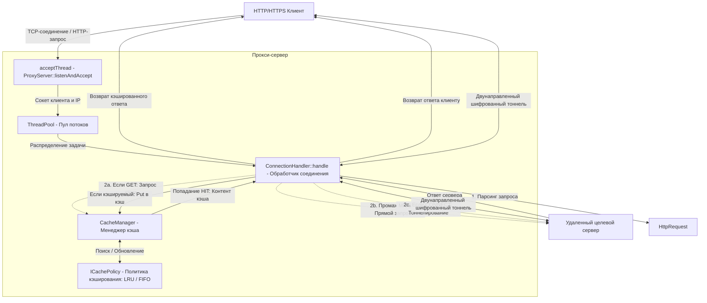

# Корпоративный HTTP-кэширующий прокси-сервер — Архитектура и техническая документация

В данном документе приведено детальное описание архитектуры, паттернов проектирования, основных компонентов и низкоуровневой реализации корпоративного кэширующего прокси-сервера.

---

## 1. Общий обзор архитектуры

Система представляет собой многопоточный высокопроизводительный демон прокси-сервера HTTP/HTTPS, написанный на **C++17** с использованием стандартных системных вызовов POSIX BSD Sockets. Сервер предназначен для перехвата HTTP-запросов клиентов, отдачи кэшированных ответов (что снижает нагрузку на сеть и задержки) и установки сквозных двунаправленных TCP-туннелей для безопасного трафика HTTPS.

### Схема взаимодействия компонентов

---

## 2. Основные компоненты проекта и структура классов

Исходный код проекта разделен на логические модули:

### 2.1. Сетевое взаимодействие и цикл сервера
- **[ProxyServer](file:///home/baabbabai/GitHub/Project_Mireacle/4th-semester/PoCS/Proxy-Project-4/include/ProxyServer.h) и [ProxyServer.cpp](file:///home/baabbabai/GitHub/Project_Mireacle/4th-semester/PoCS/Proxy-Project-4/src/ProxyServer.cpp)**
  Управляет жизненным циклом сервера. Инициализирует слушающий TCP-сокет, привязывает его к порту, устанавливает опцию `SO_REUSEADDR` для быстрого перезапуска демона и настраивает параметры кэширования.
  - `start()`: Выделяет пул потоков, запускает фоновый поток `acceptThread`, вызывающий `listenAndAccept()`.
  - `stop()`: Атомарно переводит статус работы в `false`, закрывает слушающий сокет и ожидает завершения потоков.
  - `listenAndAccept()`: Метод, выполняемый в фоновом потоке. Он опрашивает состояние главного сокета с помощью вызова `select()` с тайм-аутом в 1 секунду. При появлении входящего соединения вызывает `accept()`, извлекает IP-адрес клиента и передает задачу на обработку соединения в `ThreadPool`.

- **[ConnectionHandler](file:///home/baabbabai/GitHub/Project_Mireacle/4th-semester/PoCS/Proxy-Project-4/include/ConnectionHandler.h) и [ConnectionHandler.cpp](file:///home/baabbabai/GitHub/Project_Mireacle/4th-semester/PoCS/Proxy-Project-4/src/ConnectionHandler.cpp)**
  Реализует обработку каждого конкретного клиента внутри рабочего потока пула.
  - `handle()`: Читает сырой HTTP-запрос из сокета, парсит его и перенаправляет выполнение по одному из трех путей:
    1. **Запрос GET (`handleGet()`)**: Проверяет наличие URL в кэше. В случае попадания (Hit) возвращает кэшированный ответ. При промахе (Miss) устанавливает TCP-соединение с удаленным сервером, отправляет запрос, вычитывает ответ, проверяет его на кэшируемость (`isCacheable()`), заносит в кэш и транслирует клиенту.
    2. **Запрос CONNECT (`handleConnect()`)**: Разрешает DNS-имя через `getaddrinfo()`, подключается к удаленному хосту по TCP, отправляет клиенту статус `HTTP/1.1 200 Connection Established` и запускает метод `tunnel()`.
    3. **Другие методы запросов (`handlePassThrough()`)**: Просто перенаправляет сырые данные (например, POST, PUT) удаленному серверу и возвращает ответ напрямую, минуя кэширование.
  - `tunnel(int serverSocket)`: Создает двунаправленный ретранслятор между клиентским и серверным сокетами. С помощью системного вызова `select()` в цикле ожидает готовности данных на чтение на обоих сокетах и мгновенно копирует байты из одного сокета в другой.
  - `readFromSocket(int socket, bool& disconnected)`: Динамически считывает заголовки запроса до достижения лимита в 8192 байта или до обнаружения разделителя заголовков HTTP `\r\n\r\n` (или `\n\n`).

### 2.2. Модель многопоточности
- **[ThreadPool](file:///home/baabbabai/GitHub/Project_Mireacle/4th-semester/PoCS/Proxy-Project-4/include/ThreadPool.h) и [ThreadPool.cpp](file:///home/baabbabai/GitHub/Project_Mireacle/4th-semester/PoCS/Proxy-Project-4/src/ThreadPool.cpp)**
  Реализация пула потоков фиксированного размера.
  - **Конструктор**: Запускает $N$ рабочих потоков с бесконечным циклом. Потоки заблокированы на условной переменной `cv.wait()` до тех пор, пока в очереди задач не появится новая функция для выполнения, либо пока пул не будет остановлен.
  - `enqueue(std::function<void()> task)`: Потокобезопасно добавляет задачу в очередь с захватом мьютекса очереди через `std::lock_guard` и будит один из спящих потоков через `cv.notify_one()`.
  - **Деструктор**: Переводит флаг остановки в `true`, будит все потоки и вызывает метод `join()` для каждого рабочего потока, обеспечивая чистое завершение программы без утечек ресурсов.

### 2.3. Система кэширования и вытеснения данных
- **[CacheManager](file:///home/baabbabai/GitHub/Project_Mireacle/4th-semester/PoCS/Proxy-Project-4/include/CacheManager.h) и [CacheManager.cpp](file:///home/baabbabai/GitHub/Project_Mireacle/4th-semester/PoCS/Proxy-Project-4/src/CacheManager.cpp)**
  Потокобезопасный реестр кэша, реализованный в виде Синглтона (Singleton).
  - **Политика блокировок**: Использует разделяемый мьютекс `std::shared_mutex` (`cacheMutex`) для высокой степени параллелизма. Чтение кэша (`get()`) выполняется под разделяемой блокировкой (`std::shared_lock`), что позволяет множеству потоков читать кэш одновременно. Запись, очистка или изменение лимитов кэша (`put()`, `clear()`, `setLimit()`) требуют монопольной блокировки (`std::unique_lock`).
  - `get(url, out_content)`: Производит поиск данных в хэш-таблице `cacheStorage`. В случае успеха обновляет статус использования элемента через `policy->touch(url)`.
  - `put(url, content)`: Записывает новые данные. Перед добавлением вызывает `evictToFit()` для освобождения памяти до размера `neededBytes`.
  - `evictToFit(neededBytes)`: В цикле запрашивает у выбранной политики имя кандидата на удаление с помощью `policy->getCandidateToEvict()`, стирает его из `cacheStorage` и уменьшает `currentSize` до тех пор, пока текущий размер кэша с учетом новых данных не впишется в установленный лимит памяти.

- **[ICachePolicy](file:///home/baabbabai/GitHub/Project_Mireacle/4th-semester/PoCS/Proxy-Project-4/include/ICachePolicy.h)**
  Абстрактный интерфейс для управления алгоритмами вытеснения: методы `touch(key)`, `insert(key, size)`, `erase(key)` и `getCandidateToEvict()`.

- **[LRUPolicy](file:///home/baabbabai/GitHub/Project_Mireacle/4th-semester/PoCS/Proxy-Project-4/include/LRUPolicy.h) и [LRUPolicy.cpp](file:///home/baabbabai/GitHub/Project_Mireacle/4th-semester/PoCS/Proxy-Project-4/src/LRUPolicy.cpp)**
  Алгоритм вытеснения наименее недавно использованных данных (Least Recently Used). Хранит ключи в двусвязном списке `std::list<std::string> lruList` и хэширует итераторы элементов в `std::unordered_map<std::string, std::list<std::string>::iterator> lruMap`.
  - **Сложность**: Доступ и обновление выполняются за $O(1)$.
  - Метод `touch()` перемещает затронутый ключ в начало списка.
  - Кандидатом на удаление всегда становится элемент из конца списка `lruList`.

- **[FIFOPolicy](file:///home/baabbabai/GitHub/Project_Mireacle/4th-semester/PoCS/Proxy-Project-4/include/FIFOPolicy.h) и [FIFOPolicy.cpp](file:///home/baabbabai/GitHub/Project_Mireacle/4th-semester/PoCS/Proxy-Project-4/src/FIFOPolicy.cpp)**
  Алгоритм вытеснения в порядке очереди (First In First Out).
  - Метод `touch()` не выполняет никаких действий (так как порядок доступа в FIFO не влияет на вытеснение).
  - Ключи добавляются в конец очереди при вызове `insert()`.
  - Кандидатом на удаление становится первый добавленный элемент из начала списка.

### 2.4. Парсер протокола и вспомогательные классы
- **[HttpRequest](file:///home/baabbabai/GitHub/Project_Mireacle/4th-semester/PoCS/Proxy-Project-4/include/HttpRequest.h) и [HttpRequest.cpp](file:///home/baabbabai/GitHub/Project_Mireacle/4th-semester/PoCS/Proxy-Project-4/src/HttpRequest.cpp)**
  Разбирает входящие HTTP-запросы. Извлекает метод HTTP, URL, версию протокола, а также заголовки. Автоматически извлекает имя хоста (Host) и порт (обрабатывая стандартные/нестандартные схемы, запросы `CONNECT` и суффиксы заголовка Host).
  - `toRawString()`: Формирует сериализованный HTTP-запрос для отправки на оригинальный сервер, принудительно устанавливая заголовок `connection: close`.

- **[HttpResponse](file:///home/baabbabai/GitHub/Project_Mireacle/4th-semester/PoCS/Proxy-Project-4/include/HttpResponse.h) и [HttpResponse.cpp](file:///home/baabbabai/GitHub/Project_Mireacle/4th-semester/PoCS/Proxy-Project-4/src/HttpResponse.cpp)**
  Разбирает ответы от целевых серверов.
  - `isCacheable()`: Проверяет правила кэшируемости ответа. Кэшируются только успешные ответы со статусом `200 OK`. Метод проверяет заголовки `Cache-Control` на наличие директив (`no-store`, `private`, `no-cache`), а также устаревший заголовок `Pragma`. Если обнаружены признаки запрета кэширования, данные не сохраняются.

- **[Config](file:///home/baabbabai/GitHub/Project_Mireacle/4th-semester/PoCS/Proxy-Project-4/include/Config.h) и [Config.cpp](file:///home/baabbabai/GitHub/Project_Mireacle/4th-semester/PoCS/Proxy-Project-4/src/Config.cpp)**
  Служит для разбора параметров конфигурационного файла:
  - `port`: Слушающий порт сервера.
  - `threads`: Количество рабочих потоков в пуле.
  - `cache_limit_mb`: Максимальный лимит памяти под кэш в мегабайтах.
  - `policy`: Используемый алгоритм вытеснения кэша (`LRU` или `FIFO`).

- **[Logger](file:///home/baabbabai/GitHub/Project_Mireacle/4th-semester/PoCS/Proxy-Project-4/include/Logger.h) и [Logger.cpp](file:///home/baabbabai/GitHub/Project_Mireacle/4th-semester/PoCS/Proxy-Project-4/src/Logger.cpp)**
  Потокобезопасная служба ведения логов. Для вывода информации в консоль использует мьютекс `std::lock_guard<std::mutex>`. Выводит отформатированные метки времени и идентификаторы вызвавших системных потоков.

- **[main.cpp](file:///home/baabbabai/GitHub/Project_Mireacle/4th-semester/PoCS/Proxy-Project-4/src/main.cpp)**
  Точка входа. Устанавливает обработчики сигналов `SIGINT` и `SIGTERM` для плавного завершения демона, считывает путь к конфигурационному файлу и запускает цикл сервера.

---

## 3. Системные вызовы и низкоуровневые API методы

В проекте не используются тяжелые сторонние зависимости — вся сетевая работа и синхронизация реализована через стандартные механизмы:

### 3.1. Сетевые вызовы BSD Linux Sockets
1. `socket(domain, type, protocol)`: Создает конечную точку (дескриптор сокета) для обмена данными (`AF_INET`, `SOCK_STREAM` для TCP).
2. `setsockopt(sockfd, level, optname, ...)`: Настраивает параметры сокета. Используется опция `SO_REUSEADDR` для быстрого переиспользования порта без ожидания закрытия предыдущих соединений ядром ОС.
3. `bind(sockfd, addr, ...)`: Ассоциирует сокет с локальным IP-адресом и портом.
4. `listen(sockfd, backlog)`: Переводит сокет в режим прослушивания входящих соединений с очередью backlog до 128 запросов.
5. `accept(sockfd, addr, ...)`: Извлекает первый запрос из очереди соединений сокета и создает для него новый дескриптор.
6. `select(nfds, readfds, ...)`: Позволяет контролировать готовность нескольких файловых дескрипторов к чтению/записи без блокировки потоков. Применяется в `listenAndAccept()` для своевременного выхода при получении сигналов остановки, а также в `tunnel()` для двустороннего ретранслирования данных.
7. `recv(sockfd, buf, len, flags)`: Принимает данные из подключенного сокета.
8. `send(sockfd, buf, len, flags)`: Отправляет данные через сокет.
9. `getaddrinfo(...)` / `freeaddrinfo(...)`: Потокобезопасное разрешение доменных имен в IP-адреса (DNS-запросы).

### 3.2. Синхронизация и потоки C++
1. `std::thread`: Запуск фонового прослушивания соединений.
2. `std::mutex` и `std::lock_guard`: Защита от состояния гонки (Data Race) в логировании и очереди задач.
3. `std::shared_mutex`, `std::shared_lock` и `std::unique_lock`: Используются в `CacheManager` для реализации паттерна Read-Write Lock (параллельное чтение несколькими потоками, монопольная запись).
4. `std::condition_variable`: Оповещение рабочих потоков пула о появлении новых задач в очереди.

---

## 4. Сборка, контейнеризация и тестирование

- **Сборка проекта**: Конфигурируется в [CMakeLists.txt](file:///home/baabbabai/GitHub/Project_Mireacle/4th-semester/PoCS/Proxy-Project-4/CMakeLists.txt). Исходные коды собираются в статическую библиотеку `proxy_core`, которая затем связывается с исполняемым файлом `proxy_server`. Для обеспечения высокого качества кода применены строгие флаги компилятора: `-Wall -Wextra -Wpedantic`.
- **Контейнеризация**: Конфигурируется в [Dockerfile](file:///home/baabbabai/GitHub/Project_Mireacle/4th-semester/PoCS/Proxy-Project-4/Dockerfile). Используется **многоэтапная сборка (multi-stage build)**:
  1. **Этап сборщика (builder)**: Устанавливает компиляторы и утилиты (`build-essential`, `cmake` и др.), копирует исходный код, выполняет сборку в Release режиме и прогоняет юнит-тесты (`ctest`).
  2. **Этап ранера (runner)**: Копирует только собранный бинарник (`proxy_server`), файлы тестов и конфиг в чистый минимальный образ Ubuntu 22.04, минимизируя размер итогового контейнера.
- **Тестирование**: Код тестов находится в папке `/tests`. Включает модульное тестирование менеджера кэша, конфигуратора, парсинга HTTP, алгоритмов вытеснения, пула потоков, а также интеграционные сценарии сокетов (`testScenario`).
